# Pairing App

A simple, offline tournament pairing app for Android, built **TCG-first** (Magic, Pokémon, Yu-Gi-Oh!, Lorcana, ...).
It runs **Swiss**, **single elimination** and **double elimination** tournaments, lets you **chain stages** (for example
Swiss followed by a Top 8 cut), keeps live **standings with tiebreakers**, runs a **round timer with an alarm**, lets you
**drop players** between rounds, records **deck names** at the end, and exports the results as **images**.

Everything is stored on the phone. There is no account, no server and no network access.

> The player and deck names in every screenshot below are made-up demo data.

<p align="center">
  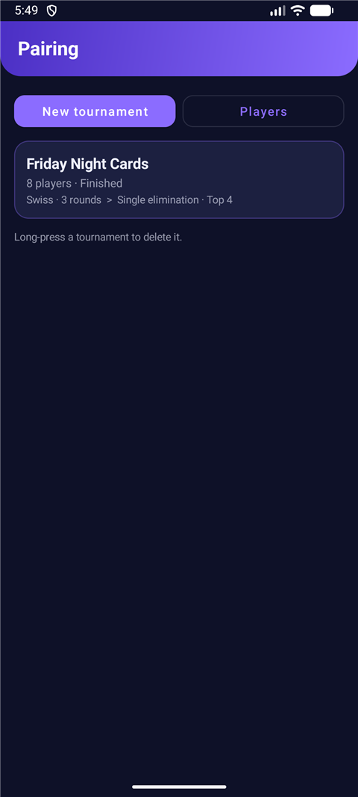
  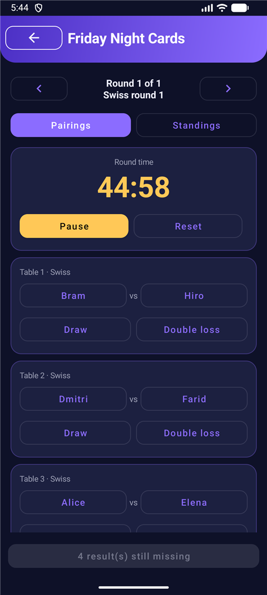
  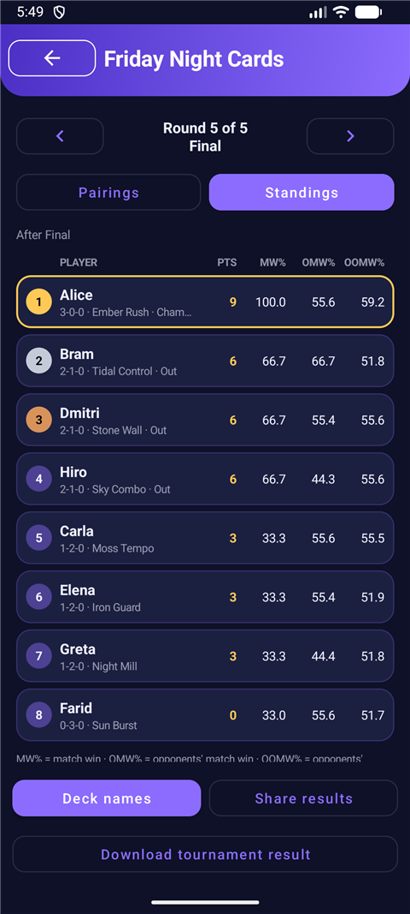
  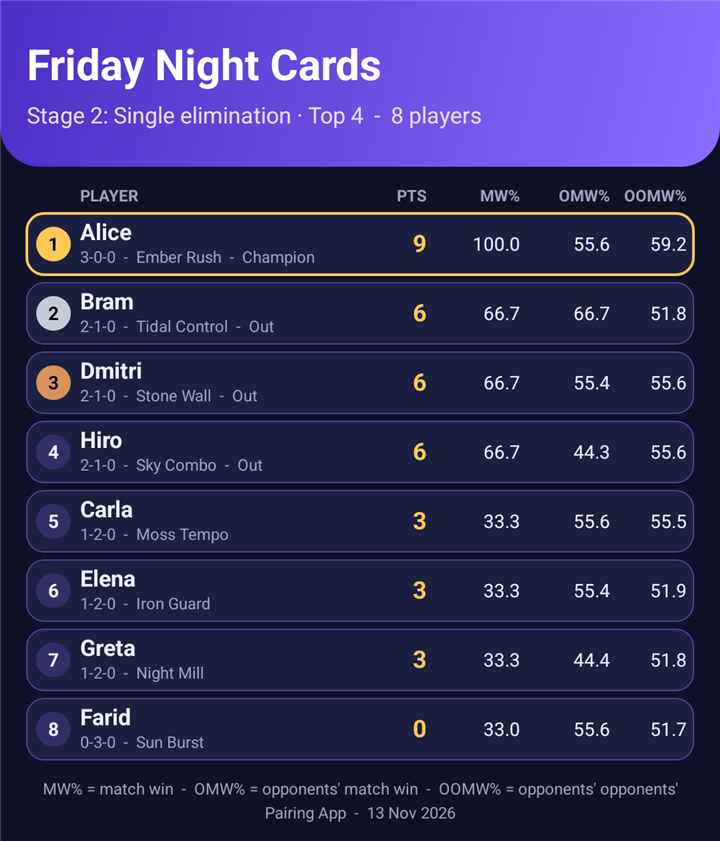
</p>

---

## Contents

1. [Features](#features)
2. [A tour of the app](#a-tour-of-the-app)
3. [How it works](#how-it-works)
4. [Data, storage and permissions](#data-storage-and-permissions)
5. [Project structure](#project-structure)
6. [Build, run and test](#build-run-and-test)
7. [Known caveats and to-do list](#known-caveats-and-to-do-list)

---

## Features

| Area | What you get |
| --- | --- |
| **Formats** | Swiss, single elimination, double elimination, or any chain of them (e.g. Swiss, then Top 8 single elimination). |
| **Points** | You choose the points for a **win**, **draw**, **loss**, **double loss** and a **bye** when you create the tournament. Negative values work. |
| **Players** | A registered player list that is kept between tournaments, plus a text input to add a new player right on the new-tournament page. |
| **Standings** | Rank, player, points, W-L-D, **match win % (MW%)**, **opponents' match win % (OMW%)**, **opponents' opponents' match win % (OOMW%)**, status and deck. View the standings after any past round. |
| **Round timer** | Minutes per round (default 45, 0 turns it off) and an optional **additional time** that restarts the clock automatically when it hits zero. At zero the phone **vibrates and plays the default alarm ringtone**. |
| **Drop players** | After each round you review the current standings first, and can drop (or reinstate) players with a confirmed bin button before the next round is paired. |
| **Decks** | A deck-name screen at the end of the tournament, with autocomplete from decks you used before. |
| **Export** | Share the results as text, or **download them as PNG images**. With several stages you pick which stage results to download. |
| **Look** | A dark violet-and-gold theme. Everything is one Activity with programmatic views, so there are no extra dependencies beyond AppCompat and Material. |

---

## A tour of the app

### 1. Register players and set up a tournament

Register players once on the **Players** screen. They are then available for every tournament.

<p>
  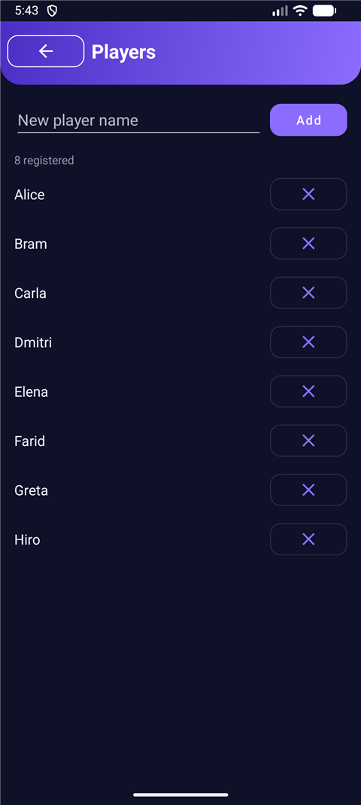
  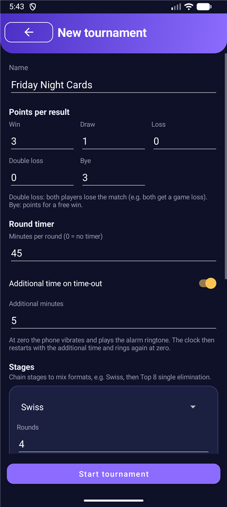
  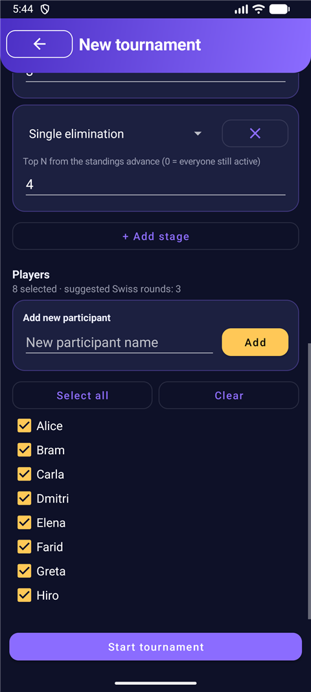
</p>

On **New tournament** you set:

- the **name** and the **points** per result (win / draw / loss / double loss / bye). A *double loss* means both players lose the match, for example when both get a game loss. A *bye* is the points awarded for a free win;
- the **round timer**: minutes per round, and an optional *additional time on time-out*;
- the **stages**. Add as many as you like and mix formats. Swiss takes a number of rounds; an elimination stage takes "Top N" (0 means everyone still active). The first stage always takes everyone, seeded randomly. The page suggests a Swiss round count for the number of players you select;
- the **players**: tick them from the registered list, or type a new participant into **Add new participant** and press Add. The new player is saved to the list and ticked for this tournament.

### 2. Run a round

<p>
  
</p>

The **Pairings** tab shows the current round: a timer card on top (Start / Pause / Resume, Reset, Silence), then one card per table.
Tap the winner's name to report a result (tap it again to undo), or use **Draw** / **Double loss** in Swiss rounds. A bye is awarded automatically.
The chevrons at the top browse earlier rounds. Earlier rounds are read-only; only the current round can be edited.

When every result is in, the bottom button becomes **Next round**.

### 3. Review the standings and drop players before pairing

Pressing **Next round** does *not* pair immediately. It opens the standings so you can drop players who have left:

<p>
  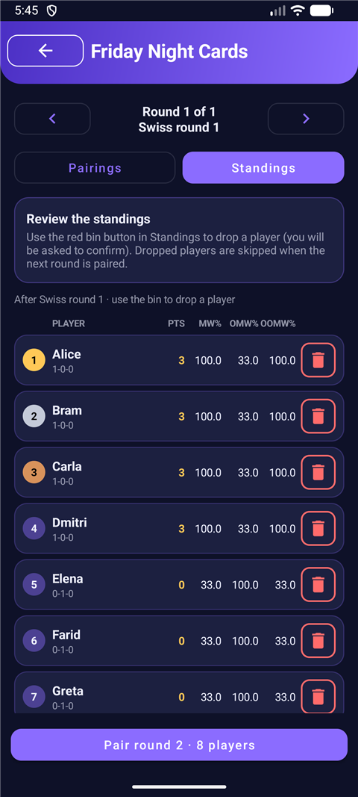
  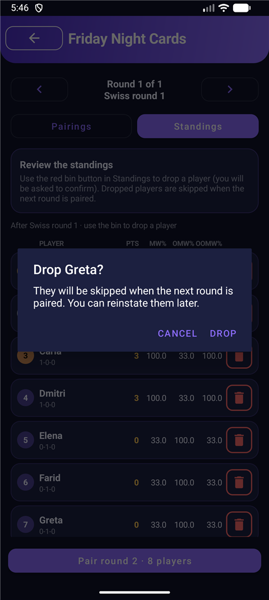
  
</p>

- Each row has a red-bordered **bin** button at the far right. It asks for confirmation ("Drop Greta?") before doing anything.
- Dropped players are dimmed, tagged *Dropped*, and get a **restore** button instead.
- The button at the bottom shows how many players are active: **Pair round 2 · 8 players**. Press it to pair the rest.
- The same preview appears when a Swiss stage ends and an elimination stage follows, so you can drop players before the cut.
- It is skipped for elimination rounds, and when the next press would finish the tournament.

### 4. Elimination stages

<p>
  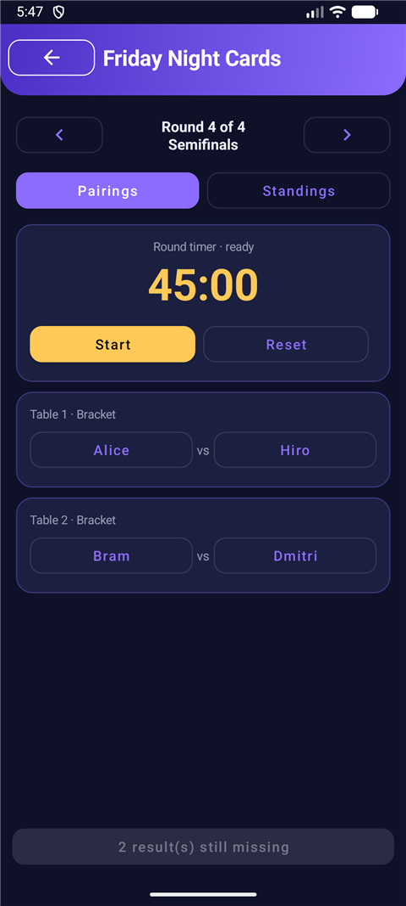
</p>

An elimination stage takes the **top N of the standings so far** (dropped players excluded) and seeds them. Elimination matches only have a winner (no draws).
Single elimination handles byes for the top seeds when the field is not a power of two. Double elimination has a winners bracket, a losers bracket and a grand final with a bracket reset.

### 5. Finish: decks, share, download

<p>
  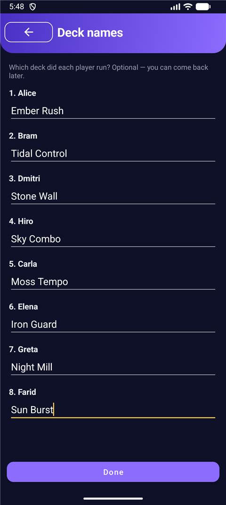
  
  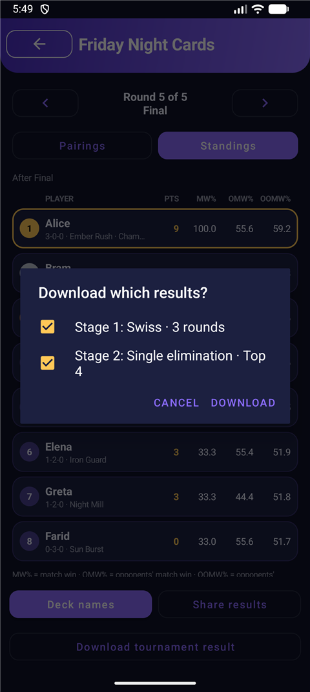
</p>

When the last round is reported and you press **Finish tournament**, the deck-name screen opens (it is optional, and you can return to it with **Deck names**).
The finished tournament shows the final standings with the champion highlighted, plus:

- **Share results**: the standings as plain text through the Android share sheet;
- **Download tournament result**: saves PNG images to `Pictures/PairingApp`. With one stage it saves straight away. With several stages a picker lists each stage's result
  ("Stage 1: Swiss · 3 rounds", "Stage 2: Single elimination · Top 4"); the last stage is pre-ticked and each ticked result becomes its own image showing the standings **as they stood when that stage ended**.
  Fields over 50 players are split into pages.

<p>
  
  
</p>

---

## How it works

All tournament logic lives in `app/src/main/java/com/example/pairingapp/engine/` and has no Android dependencies except `Store`, so it is unit tested on the JVM.

### Tournament flow

A tournament is an ordered list of **stages**. Each stage generates rounds one at a time:

1. `start()` creates round 1 of stage 1.
2. When every result of the current round is reported, `advance()` either creates the next round of the same stage, starts the next stage, or finishes the tournament.
3. Only the **current round** can be edited. Once the next round exists, earlier results are locked.

A stage is complete when: a Swiss stage has played its rounds; a single-elimination bracket is down to one match; a double-elimination bracket has played its grand final (and the reset match if needed).

### Swiss pairing

- Round 1 is a random shuffle. Later rounds sort players by points (random order among equal scores).
- A backtracking search pairs neighbours in that order while **avoiding rematches**.
- With an odd number of players, the **bye goes to the lowest-ranked player who has not had one yet**.
- The search is time-boxed: each attempt gets 300 ms and all attempts together get 2 seconds (an even field has a single attempt, so it gives up after about 0.3 s). If no rematch-free pairing is found in time, or none exists, it falls back to pairing neighbours and allows rematches.
- **Dropped players are skipped.** The field for each round comes from the stage's first round, so a reinstated player is paired again.

### Single elimination

Entrants are seeded from the standings (random for a first stage). The bracket uses standard seeding (1 plays last, 2 plays second-to-last, ...), and the top seeds get byes when the count is not a power of two. Each next round pairs the previous winners in bracket order.

### Double elimination

Players have two lives. Each round pairs the winners-bracket players among themselves and the losers-bracket pool among themselves:

- Players who just dropped from the winners bracket are paired against veterans of the losers bracket first, and leftovers pair among themselves (an odd one gets a bye).
- A second loss eliminates a player.
- When one winners-bracket player and one losers-bracket player remain they meet in the **grand final**. If the losers-bracket player wins, a **reset match** decides the champion.

### Standings and tiebreakers

Points come from your point system. For tiebreakers:

- **MW%** = (wins + draws / 3) ÷ rounds played, with a floor of 33%. A bye counts as a win. A double loss counts as a loss.
- **OMW%** = the average MW% of the opponents you actually played (byes are not opponents), each floored at 33%.
- **OOMW%** = the average OMW% of those opponents.
- Players are ordered by: elimination result (when an elimination stage has started), then **points, OMW%, OOMW%, MW%**, then name.

Points and tiebreakers are computed from the **Swiss rounds only** (or from every match when the tournament has no Swiss stage). Once an elimination stage starts, its participants rank above everyone else: the champion first, then players ordered by how late they were eliminated, then the rest by their Swiss standing.
You can view the standings as they were after any round.

### Dropping players

Dropping flags a player as *dropped* for the whole tournament. Dropped players keep their results and stay in the standings, but they are skipped by every later pairing and by the cut into an elimination stage. Reinstating clears the flag. The standings preview before each round is where this is done.

### Round timer and alarm

- `TimerCore` is a small pure state machine (idle, round, additional time, done) with an injectable clock, so it is unit tested.
- `RoundTimer` drives it with a UI ticker for the on-screen clock and keeps the screen awake while the clock runs.
- Time-outs are scheduled with `AlarmManager.setAlarmClock`, so they fire even when the app is in the background. The receiver vibrates, plays the default alarm ringtone for up to 8 seconds, and **chains the additional-time alarm itself**. If Android refuses exact alarms, the app rings from the in-app ticker instead.
- Every new round starts with a fresh clock. Pressing Start / Pause / Reset also silences a ringing alarm.

### Result images

`ResultImage` draws the standings table onto a bitmap with `Canvas` (no views are captured), in the app's colours, and saves it through `MediaStore` to `Pictures/PairingApp`.
Standings for each stage come from `Tournament.stageResults()`, which freezes the standings at the last round of every stage.

---

## Data, storage and permissions

- **Storage**: the player list and all tournaments are saved as JSON in `SharedPreferences` (`pairing_store`). Saves are debounced (500 ms) and flushed whenever the app goes to the background or a round is advanced.
  A tournament record that cannot be read is skipped, and the raw data is copied once to `backup_roster` / `backup_tournaments` so a bad record cannot wipe your history.
- **Android Auto Backup** is on (`allowBackup`), so data may be restored when you move to a new phone with the same Google account. There is no manual export or import.
- **Permissions**:

| Permission | Why |
| --- | --- |
| `VIBRATE` | Buzz at time-out. |
| `WAKE_LOCK` | Keep the on-screen clock ticking while the screen is off. |
| `USE_EXACT_ALARM`, `SCHEDULE_EXACT_ALARM` (Android 12 and below) | Schedule the time-out alarm so it fires on time. |
| `WRITE_EXTERNAL_STORAGE` (Android 9 and below only) | Save result images. Android 10+ needs no permission. |

---

## Project structure

```
app/src/main/java/com/example/pairingapp/
  engine/
    Model.kt          Players, point system, stages, matches, standings data classes
    Tournament.kt     Rounds, stages, elimination brackets, standings and tiebreakers
    SwissPairer.kt    Rematch-avoiding Swiss pairing with bye handling
    TimerCore.kt      Pure countdown state machine
    Store.kt          JSON persistence in SharedPreferences
  ui/
    MainActivity.kt   All screens (home, players, setup, tournament, decks) and navigation
    Ui.kt             Small view helpers (buttons, cards, badges, icon buttons)
    RoundTimer.kt     Drives TimerCore, wake lock, alarm scheduling
    TimerAlarm.kt     AlarmManager scheduling, alarm receiver and the ring/vibrate player
    ResultImage.kt    Draws and saves the standings images
app/src/main/res/drawable/   Vector icons (back, chevrons, close, bin, restore)
app/src/test/                Unit tests for the engine and timer
docs/screenshots/            Images used by this README
```

---

## Build, run and test

Requirements: Android Studio (or a JDK 17+ and the Android SDK), and a device or emulator running Android 7.0 (API 24) or newer. The app targets API 37.

```bash
# unit tests (engine and timer logic)
./gradlew testDebugUnitTest

# build a debug APK -> app/build/outputs/apk/debug/app-debug.apk
./gradlew assembleDebug

# install and launch on a connected device or emulator
adb install -r app/build/outputs/apk/debug/app-debug.apk
adb shell am start -n com.example.pairingapp/.ui.MainActivity
```

On Windows use `gradlew.bat`. If `JAVA_HOME` is not set, point it at Android Studio's bundled JDK (the `jbr` folder).

The unit tests cover Swiss pairing (no rematches, byes), single and double elimination (including byes, bracket reset and a lone entrant), mixed stages, custom points and tiebreakers, dropping and reinstating players, per-stage results, and the timer state machine.
There are no UI or instrumentation tests, and `Store` (JSON persistence) is not unit tested.

---

## Known caveats and to-do list

These are the problems and limitations known today. They are grouped by area; none of them stops the app from running a tournament.

### Things most likely to bite in real use

- **Only one active player left can block progress.** The "at least 2 active players" guard in the standings preview also applies when moving into an elimination stage. If everyone but one player has dropped, you have to reinstate someone to continue.
- **Results of earlier rounds cannot be edited**, and there is no undo once the next round is paired. A wrong result found a round later cannot be fixed.
- **Timer state is kept in memory only.** If Android kills the app mid-round, the on-screen clock is lost, although the alarm that was already scheduled can still ring. If you open a different tournament, the clock is reset and its pending alarm is cancelled.
- **Alarms depend on the phone's battery settings.** Some manufacturers delay or kill background alarms. The vibration has only been checked in code, not on hardware, and the screen-off behaviour should be tried on your own phone.
- **Swiss rounds >= players** (for example 5 rounds with 4 players) silently force rematches. There is no warning on the setup page.

### Round timer

- Deleting a tournament does not cancel its pending alarm, so it can still ring.
- Any new `MainActivity` instance (for example after a configuration change that is not handled, or with the developer option "Don't keep activities") cancels the pending alarm the first time a tournament is opened.
- The clock uses wall-clock time, so a manual clock change or an automatic time sync during a round shifts it.
- Additional time starts when the app notices the first time-out, not at the exact moment of it.
- Pausing at the exact moment of a time-out can ring twice. If the chained additional-time alarm cannot be scheduled, the additional-time end does not ring.
- Silence is only reachable from the timer card, and Pause also silences the alarm. Backing out of the app on Android 11 and below drops a running timer.
- `USE_EXACT_ALARM` may be rejected by Google Play policy if you publish there (fine for sideloading). The wake lock is probably no longer needed now that alarms are scheduled with `AlarmManager`, and it costs some battery.

### Standings preview and dropping

- Before an elimination cut, the preview button counts **all active players** ("Top 8 · 30 players") instead of the number who actually enter.
- The preview card stays visible while you browse older rounds, even though there are no bins there. After the last Swiss stage the toast says "next round" although the next press finishes the tournament.
- On narrow phones (360 dp wide) or larger font sizes, the standings columns are tight: the **OOMW%** header and `100.0` values can clip. The status/deck line truncates long text (for example "Champion" becomes "Cham...").
- The bin buttons are 40 dp, smaller than the recommended 48 dp touch target.
- Dropped state is stored for the whole tournament, not per round. A stage image or an old round's standings can show a player as *Dropped* even if they dropped in a later round, and decks entered later appear on every stage's image.

### Downloads and sharing

- File names keep only ASCII letters and digits, so tournaments named in other scripts all become `tournament_results.png`. Android 10+ auto-renames duplicates; on Android 9 and below a second download would overwrite the first.
- The image footer legend can clip with wide fonts, and its last item reads "opponents' opponents'" without "match win".
- Android 9 and below: a double tap before granting storage permission can lose the pending download, and "never ask again" gives no route to Settings.
- Multi-page output (more than 50 players) and the Android 9 permission path are untested. Page names are not zero-padded (`_p10` sorts before `_p2`).
- The "Saving..." toast is followed almost at once by the result toast, and the toast keeps a reference to the Activity until a big save ends.

### Tournament rules and engine

- **Swiss is not a full Dutch system.** Players are paired with the nearest available opponent in the standings that they have not met, found by a time-boxed search. On a slow phone the time box can expire and allow a rematch that could have been avoided.
- **No game wins.** Only match results are recorded, so there is no game-win percentage (GW%) tiebreaker.
- **No manual pairing, table assignment or re-pairing** of a round once it has been generated.
- Elimination has **no draws**, no double loss, and no third-place match. A double loss is only possible in Swiss.
- Double elimination pairs the losers pool by a simple rule (veterans against fresh drops) rather than a fixed bracket, so rematches can occur. A two-player double elimination is just a rematch.
- Entrants for a stage after the first are always the top N of the standings; there is no way to hand-pick them.
- A tournament cannot be renamed or edited after it is created, and players cannot be renamed (only removed from the registered list; past tournaments keep their copy).

### Data and platform

- All data is local. There is **no export or import** of tournaments, no cloud sync, and no multi-device use. Uninstalling the app deletes everything (Auto Backup may restore it).
- On load, a bad roster entry drops the rest of the roster (the roster is parsed all-or-nothing), and the raw-data backup is only written once.
- Strings are hard-coded in English. The theme is dark only. Some device fonts miss symbols such as arrows; the app uses vector icons and plain text for that reason.
- **Back button bug:** the root-screen Back handler disables itself and is never re-enabled. On Android 12 and newer, pressing Back on the home screen sends the app to the background instead of closing it; after returning, Back on a nested screen can then leave the app instead of going back one screen.
- Rotation is handled by not recreating the Activity (`configChanges`), not by saving screen state. Screens that are not saved (for example a half-filled new-tournament form) are lost if Android kills the process.
- No release signing configuration, CI, or lint setup yet.

### Ideas for later

- Save the round timer so it survives the app being killed, and cancel alarms for deleted tournaments.
- Edit earlier results with an undo, and let the organiser pair or swap players by hand.
- Game-win percentage and optional game scores.
- Export and import (JSON or CSV) for backups and for moving to another phone.
- Zero-padded, Unicode-friendly file names and a share-as-image button next to download.
- A light theme, translations, and tablet / landscape layouts.
- UI tests and a unit test for `Store`.
